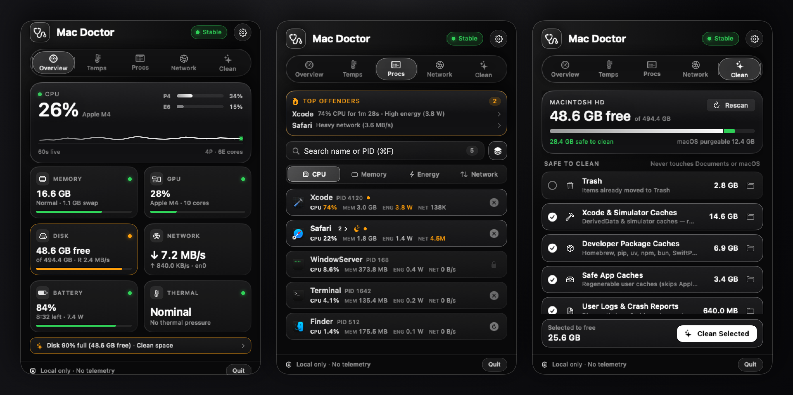
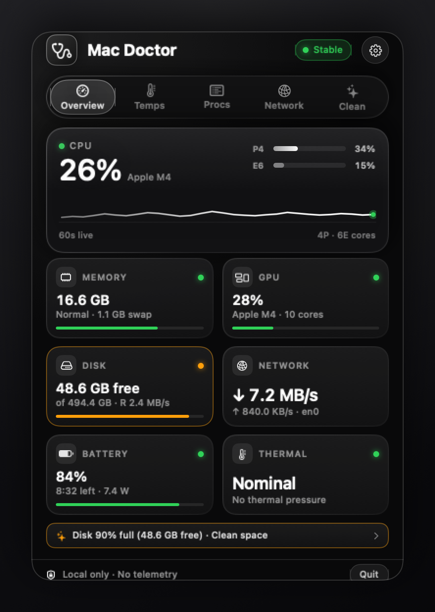
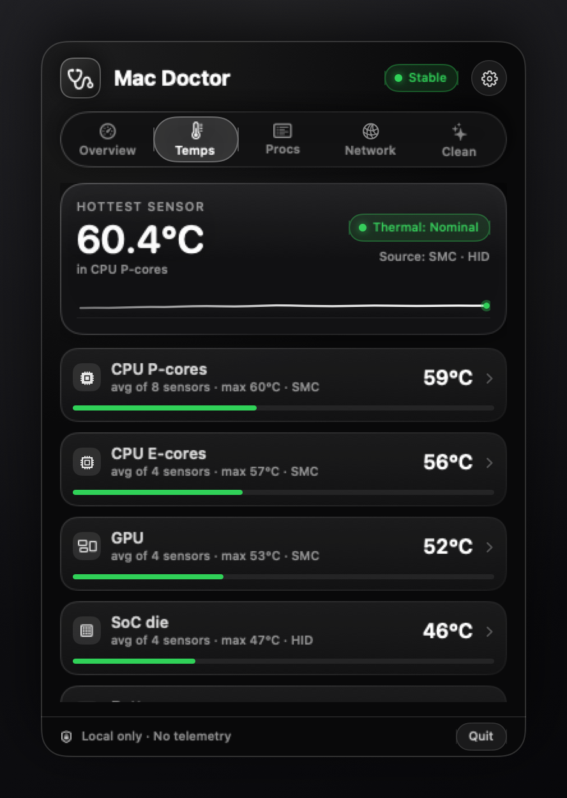
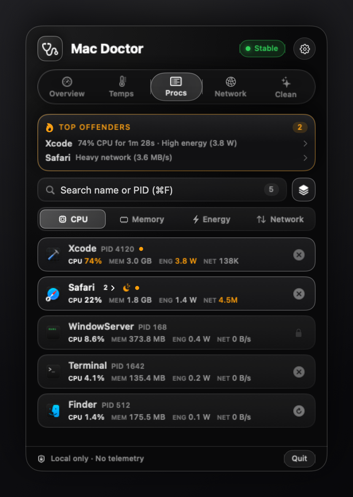
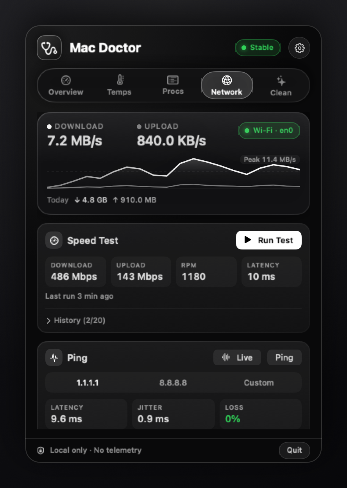
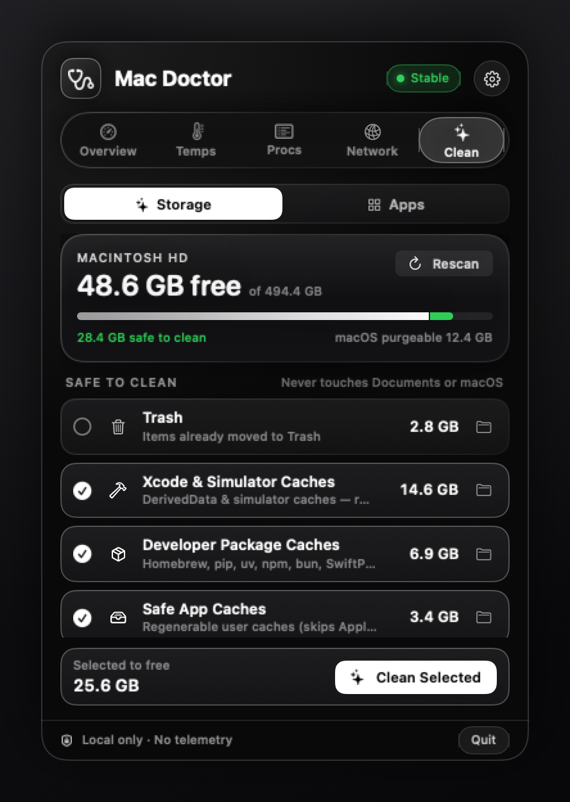
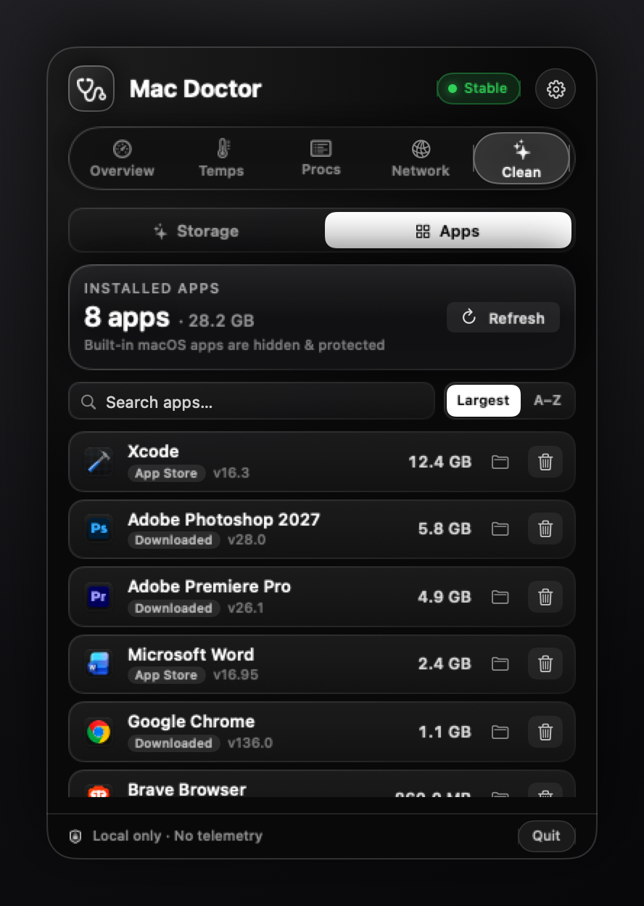

<div align="center">


# Mac Doctor

**Activity Monitor + iStat Menus + Safe Disk Cleaner + App Uninstaller — in one free, ~2.4 MB native Swift 6 menu bar app.**

Built for Apple Silicon Macs (macOS 15+ & macOS 26 Liquid Glass).  
**Zero root. Zero telemetry. Zero third-party dependencies. Zero subscriptions.**

[](https://github.com/Moeraafatz/mac-doctor/releases/latest)

<br />

[](#building--installing)
[](#features)
[](#architecture)
[](#security--privacy-model)
[](LICENSE)

<br />



</div>

---

## Why Mac Doctor?

Most Mac utilities make you choose between bloated paid suites, subscription "cleaners" that ask for your admin password, or juggling four separate menu bar icons.

**Mac Doctor** puts everything you actually check every day into one ultra-lightweight Black Liquid Glass popover:

| | **Mac Doctor** | Paid Monitor Suites | Paid Mac Cleaners | Built-in Activity Monitor |
| :--- | :---: | :---: | :---: | :---: |
| **Price** | **Free & Open Source (MIT)** | $10–$18 | $35–$90/yr | Free |
| **App Size / Idle RAM** | **~2.4 MB / ~16 MB RAM** | 40–100 MB | 150–400 MB | Built-in |
| **Zero Root / Zero Helper Daemons** | ✅ | ⚠️ Often needs helper | ❌ Needs admin | ✅ |
| **Apple Silicon Per-Sensor Temps** | ✅ | ✅ | ❌ | ❌ |
| **Grouped Task Manager + Safe Kill** | ✅ | ❌ | ❌ | ⚠️ Separate app |
| **Built-in Speed Test + Live Ping + Wi-Fi** | ✅ | ⚠️ Partial | ❌ | ❌ |
| **Safe Dev Cache & System Data Cleaner** | ✅ | ❌ | ✅ | ❌ |
| **Deep App Remover (App + `~/Library` Leftovers)** | ✅ | ❌ | ✅ | ❌ |
| **Zero Telemetry / Background Calls** | ✅ | ⚠️ Varies | ❌ | ✅ |

---

## Screenshots

<table>
  <tr>
    <td align="center" width="50%">
      <br />
      <strong>Overview (`⌘1`)</strong><br />
      <sub>CPU P/E cluster split, 60s sparkline, GPU, Memory & Swap, Disk, Battery watts, Thermal state & Sleep-blocker triage</sub>
    </td>
    <td align="center" width="50%">
      <br />
      <strong>Temperatures (`⌘2`)</strong><br />
      <sub>Real Apple Silicon SMC + HID sensors (CPU P/E cores, GPU, SoC die, Battery, SSD) + 60s hottest-sensor curve</sub>
    </td>
  </tr>
  <tr>
    <td align="center" width="50%">
      <br />
      <strong>Task Manager (`⌘3`)</strong><br />
      <sub>Grouped apps + helpers, Top Offenders (60s+ CPU / RAM spike / energy / net), sleep-blocker badges & guarded Quit/Force Quit</sub>
    </td>
    <td align="center" width="50%">
      <br />
      <strong>Network (`⌘4`)</strong><br />
      <sub>Live throughput graph, daily GB counter, Apple <code>networkQuality</code> speed test, Live Ping sparkline, Wi-Fi RSSI/SNR, VPN & DNS</sub>
    </td>
  </tr>
  <tr>
    <td align="center" width="50%">
      <br />
      <strong>Safe Storage Cleaner (`⌘5` · Storage)</strong><br />
      <sub>One-click cleanup for Xcode DerivedData, Homebrew/pip/uv/npm/bun caches, logs & Trash + read-only System Data explorer</sub>
    </td>
    <td align="center" width="50%">
      <br />
      <strong>Deep App Remover (`⌘5` · Apps)</strong><br />
      <sub>Uninstall downloaded & App Store apps (including Adobe/subfolder suites) with exact <code>~/Library</code> leftovers — built-in macOS apps strictly protected</sub>
    </td>
  </tr>
</table>

---

## Features

### Live Menu Bar & Monochrome Black Liquid Glass UI
- **Main Black + Secondary White** design with **Green / Orange / Red** reserved strictly for live health indicators.
- Optional compact menu bar readout (**Icon only**, **CPU %**, **Temperature**, or **Network ↓/↑**).
- Menu bar icon automatically tints **amber / red** when sustained CPU (>85% for 30s), temperature, or memory pressure thresholds are crossed.
- Native **macOS 26 Liquid Glass** (`glassEffect`, `GlassEffectContainer`) behind availability checks, smooth dark translucent fallback on **macOS 15**, full **Reduce Transparency** and **Reduce Motion** support.

### 1. Overview (`⌘1`)
- **CPU:** Total %, real P-core vs E-core cluster split (read from `IODeviceTree:/cpus`), and 60-second live sparkline.
- **GPU, Memory & Disk:** GPU utilization %, memory used/total/pressure/swap, disk free space & read/write throughput.
- **Battery & Power:** %, health, cycle count, charging state, USB-C/MagSafe adapter wattage, net battery watts, and whole-system power draw (`W`).
- **Actionable Triage:** Instant 1-click banners when disk space is tight (*"Clean space"*) or an app is blocking display/system sleep (`IOPMCopyAssertionsByProcess`).

### 2. Apple Silicon Temperatures (`⌘2`)
- Per-sensor temperatures for **CPU P-cores**, **CPU E-cores**, **GPU**, **SoC die**, **Battery**, and **SSD** with a 60-second hottest-sensor sparkline.
- Built for fanless MacBooks (no fake fan section). Unreadable sensors explicitly display `"Unavailable"` — never fabricated numbers.
- Every undocumented sensor call (`IOHIDEventSystemClient` via `dlsym` + read-only `AppleSMC`) is isolated in a single file: [`MacDoctor/Services/SensorBridge.swift`](MacDoctor/Services/SensorBridge.swift).

### 3. Processes / Task Manager (`⌘3`, Search `⌘F`)
- Refreshes every 2s, sortable by **CPU %**, **Memory**, **Energy Impact**, and **Network**.
- **Grouped Apps + Helpers:** Collapses multi-process apps (Chrome/Edge/Electron/WebKit helpers) under one expandable parent row with combined CPU, RAM, Energy, and Network totals — toggle **Grouped / Flat** anytime.
- **Top Offenders Banner:** Automatically flags sustained `>50%` CPU for 60s+, `+500 MB` 5-minute RAM spikes, high energy draw, or heavy network throughput.
- **Real Energy Telemetry:** Uses kernel `rusage_info_v6.ri_energy_nj` deltas (watts) when available; any fallback estimate is explicitly labelled `"est."` / `"estimated"`.
- **Guarded Quit / Force Quit:**
  - GUI apps use `NSRunningApplication.terminate()` → `forceTerminate()` only after confirmation.
  - Background processes use `SIGTERM` first → `SIGKILL` only after a **second** confirmation.
  - **Hard blocklist** (`kernel_task`, `launchd`, `WindowServer`, `loginwindow`, `logd`, `opendirectoryd`, `coreaudiod`, `securityd`, `trustd`, `mds`, `mds_stores`, `systemstats`, `SystemUIServer`, `Dock`, and Mac Doctor itself) plus current-user UID re-verification right before signalling. **Finder** offers graceful Relaunch only.

### 4. Network Diagnostics (`⌘4`)
- **Live Throughput Graph** from `getifaddrs` + local **Today's Data Usage** counter (`↓` / `↑` GB, resets at midnight).
- **Built-in Speed Test:** Runs Apple's `/usr/bin/networkQuality -c` with live progress, cancel, download/upload Mbps, responsiveness (RPM), latency, and **20-run local history**.
- **Ping & Live Ping Mode:** Preset (`1.1.1.1`, `8.8.8.8`) or strictly validated custom host (`HostValidator` prevents command/option injection), with latency, jitter, packet loss, and a toggleable **Live** 1/sec sparkline.
- **Connection & Wi-Fi Info:** Interface (`Wi-Fi` / `Ethernet`), Local IP, Router IP, DNS servers, active VPN tunnel (`utun*`), Wi-Fi RSSI, noise, SNR, channel, band, and SSID (`"Hidden (permission needed)"` without Location Services).
- **Private Public IP:** Hidden by default behind a **Show** button — fetched only on tap using an ephemeral session.

### 5. Safe Storage Cleaner & Deep App Remover (`⌘5`)
- **Storage Mode — Safe Cache Cleaner:** Cleans **only** user-owned, 100% regenerable files behind a confirmation sheet:
  - **Xcode & Simulator Caches** (`DerivedData`, `CoreSimulator/Caches`, Previews)
  - **Developer Package Caches** (`Homebrew`, `pip`, `uv`, `npm`, `yarn`, `pnpm`, `bun`, `CocoaPods`, `SwiftPM`)
  - **Safe App Caches** (`~/Library/Caches` — explicitly skipping `com.apple.*`, CloudKit, Safari, Spotlight, and Mac Doctor)
  - **User Logs & Crash Reports** (`~/Library/Logs`)
  - **Trash** (`~/.Trash`, unchecked by default)
  - **Strict Path Jail:** Verifies every file is strictly inside an allowed home-folder cache root and is never a symlink. Never touches `/System`, `Documents`, `Desktop`, `Keychains`, or `iCloud Drive`.
  - **What's in System Data (Read-Only):** Surfaces the biggest folders in `Application Support`, `Containers`, `~/.cache`, `Developer`, and `Downloads > 200 MB` with 1-click **Reveal in Finder** + macOS purgeable space & APFS snapshot count.
- **Apps Mode — Deep App Remover:**
  - Lists **only** downloaded and Mac App Store apps (including vendor subfolders like Adobe Creative Cloud / Cinema 4D and non-system aliases) — built-in macOS apps (`/System/*`, `/Applications/Utilities`, Safari, Finder, Terminal, etc.) and Mac Doctor itself are **hidden and hard-blocked**.
  - Scans exact `~/Library` leftovers (`Application Support`, `Caches`, `Containers`, `Group Containers`, `Preferences`, `Saved Application State`, `Logs`, `LaunchAgents`, `HTTPStorages`, `WebKit`, `Application Scripts`, plus vendor-nested app folders without ever touching parent vendor folders).
  - Interactive checkbox review sheet before moving selected items to **Trash** (reversible, zero root). Automatically quits running apps first and offers a 1-click **Reveal in Finder** fallback for root-owned App Store bundles.

### 6. Settings (`⌘,`)
- Refresh interval (`1s` / `2s` / `5s`), **Low Impact Mode** (automatically slows polling on battery), **Launch at Login** (`SMAppService.mainApp`), `°C` / `°F`, customizable alert thresholds, optional local macOS notifications (`UserNotifications` with 5-minute cooldown), and 1-click **Copy System Report**.

---

## Keyboard Shortcuts

| Shortcut | Action |
| :--- | :--- |
| `⌘1` – `⌘5` | Switch between Overview, Temps, Procs, Network, Clean |
| `⌘,` | Toggle Settings |
| `⌘F` | Jump to Processes & focus Search |
| `⌘R` | Refresh all metrics immediately |

---

## Building & Installing

### Requirements
- Apple Silicon Mac running **macOS 15.0 or later**
- **Xcode 16+** (Swift 6 toolchain)

### Option A — Build & Run in Xcode (Fastest)
```sh
git clone https://github.com/Moeraafatz/mac-doctor.git
cd mac-doctor
open MacDoctor.xcodeproj
```
Select the **MacDoctor** scheme and press **⌘R**.

### Option B — Build a Standalone DMG (No Paid Apple Developer Account Needed)
```sh
./build_dmg.sh --adhoc
```
1. Open `dist/MacDoctor-0.2.1.dmg` and drag **Mac Doctor.app** into **/Applications**.
2. On first launch, macOS Gatekeeper may say it cannot verify the developer — click **Done**, then open **System Settings → Privacy & Security → Open Anyway** once.

### Option C — Signed & Notarized Release DMG (Paid Developer ID)
```sh
xcrun notarytool store-credentials "macdoctor-notary" \
  --apple-id "you@example.com" \
  --team-id "YOURTEAMID" \
  --password "xxxx-xxxx-xxxx-xxxx"

DEVELOPER_ID="Developer ID Application: Your Name (YOURTEAMID)" \
NOTARY_PROFILE="macdoctor-notary" \
./build_dmg.sh
```

---

## Security & Privacy Model

### Why App Sandbox is OFF and Hardened Runtime is ON
- **App Sandbox is OFF (`ENABLE_APP_SANDBOX = NO`)** because macOS App Sandbox blocks enumerating/signalling other processes (`proc_listallpids`, `proc_pid_rusage`, `SIGTERM`/`SIGKILL`), opening the read-only `AppleSMC` thermal client, invoking `/usr/bin/nettop` & `/sbin/ping`, and scanning developer cache folders.
- **Hardened Runtime is ON (`ENABLE_HARDENED_RUNTIME = YES`)** for Developer ID release builds and notarization.

### Non-negotiable Guarantees
- **No root, no admin password, no privileged helper, no kernel extensions.**
- **Zero telemetry, analytics, or background network calls.** The only network traffic Mac Doctor ever initiates is when you explicitly click **Run Test**, **Ping / Live**, or **Show Public IP**.
- **Safe subprocess calls:** Every CLI invocation uses `Foundation.Process` with an absolute path, an explicit argument array (never shell interpolation), and a hard timeout.

### Optional Permissions
Mac Doctor asks for **zero** permissions on launch:

| Permission | Why it is used | If not granted |
| :--- | :--- | :--- |
| **Location Services** | macOS 14+ hides the Wi-Fi SSID from `CoreWLAN` without it. Location is never read, stored, or shared. | SSID shows `"Hidden (permission needed)"`; RSSI, noise, channel & band still work. |
| **Notifications** | Optional local threshold alerts (off by default). | Menu bar icon still tints amber/red. |
| **Login Items** | Optional Launch at Login via `SMAppService.mainApp`. | Launch manually from `/Applications`. |

---

## Architecture

- **MVVM + Protocol-Backed Actor Services:** Every data source sits behind a Swift protocol and polls off the main thread (`CPUService`, `GPUService`, `MemoryService`, `DiskService`, `BatteryService`, `ThermalService`, `NetworkService`, `TemperatureService`, `SleepAssertionService`, `ProcessService`, `ConnectionInfoService`, `SpeedTestService`, `PingService`, `PublicIPService`, `StorageCleanerService`, `AppRemoverService`).
- **Swift 6 Strict Concurrency:** Compiles cleanly with `SWIFT_STRICT_CONCURRENCY = complete` and zero warnings.
- **Manual QA Checklist:** See [`docs/MANUAL_TEST_CHECKLIST.md`](docs/MANUAL_TEST_CHECKLIST.md).

---

## Known Limitations

- Apple Silicon temperature sensors rely on undocumented IOKit/SMC interfaces isolated in [`SensorBridge.swift`](MacDoctor/Services/SensorBridge.swift); if Apple changes them in a future macOS release, Mac Doctor degrades gracefully to `"Unavailable"`.
- Without root, macOS returns `EPERM` for `proc_pid_rusage` on root-owned system daemons; those processes stay visible with locked Quit controls while unavailable metrics degrade cleanly.
- Built specifically for fanless Apple Silicon MacBooks (no fan speed section).

---

## Contributing

Issues, PRs, and ideas are welcome! If you find Mac Doctor useful, consider giving the repo a ⭐.
